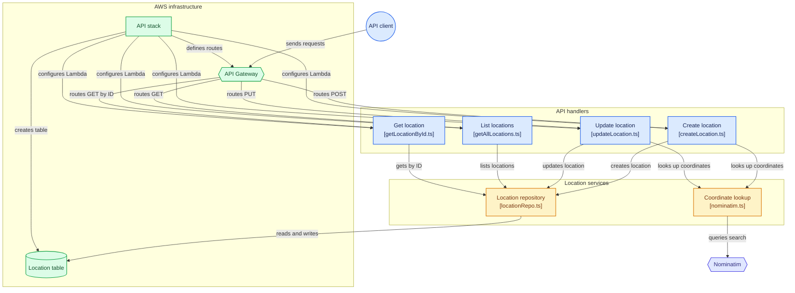

# Location API Project

A serverless RESTful API on AWS for storing and querying locations. When a location is created or updated, its **longitude** and **latitude** are automatically geocoded via **Nominatim** and stored with the record for use by the logistics side of the business.

---

## Table of Contents

- [Problem](#problem)
- [Architecture](#architecture)
- [API Reference](#api-reference)
- [DynamoDB](#dynamodb)
- [Nominatim](#nominatim)
- [Getting Started](#getting-started)
- [Testing](#testing)
- [Decisions Made](#decisions-made)
- [Challenges Faced](#challenges-faced)
- [What Would Be Different in Production](#what-would-be-different-in-production)
- [Business Value](#business-value)
- [Resources](#resources)
- [Author](#author)

---

## Problem

The organization needs a new AWS-hosted service where users can store and query **locations** through a RESTful API.

Each location record stores:

- **Location ID**
- **Location Name**
- **City**
- **State**
- **Country**
- **Longitude**
- **Latitude**

**Key requirement:** When a location is created or updated, its coordinates must be stored with the record in the `Longitude` and `Latitude` fields. These values support downstream logistics and operations use cases.

---

## Architecture

A single **AWS CDK stack** containing an API Gateway, 4 Lambda functions (one per operation), and a DynamoDB table. Create and Update also call the external Nominatim API.



### Project Structure

```
Directory structure:
└──location-api/
    ├── README.md
    ├── cdk.json
    ├── jest.config.js
    ├── package.json
    ├── tsconfig.json
    ├── .npmignore
    ├── lib/
    │   └── location-api-stack.ts
    ├── src/
    │   ├── handlers/
    │   │   ├── createLocation.ts
    │   │   ├── getAllLocations.ts
    │   │   ├── getLocationById.ts
    │   │   └── updateLocation.ts
    │   └── services/
    │       ├── locationRepo.ts
    │       └── nominatim.ts
    └── test/
        ├── location-api-test.sh
        └── location-api.test.ts
```

### Components

| Component | Responsibility |
|---|---|
| **API Gateway (REST)** | Public entry point that routes each method and path to one Lambda function. |
| **DynamoDB** | Stores locations, with a partition key of `locationId`. |
| **Lambda: Create Location** | Validates input, geocodes the address, generates the Location ID, and saves to the Location table. |
| **Lambda: Update Location** | Validates input, re-geocodes, and replaces the record **only if it already exists**. |
| **Lambda: Get Location By ID** | Reads one location record from the Location table by ID. |
| **Lambda: Get All Locations** | Returns every record in the Location table. |
| **Nominatim** | External geocoding API that turns city, state, and country into longitude and latitude coordinates. |

---

## API Reference

### Routes

- `/locations`
- `/locations/{locationId}`

### Handlers

| Operation | Method | Route |
|---|---|---|
| Create Location | `POST` | `/locations` |
| List All Locations | `GET` | `/locations` |
| Get Location by ID | `GET` | `/locations/{locationId}` |
| Update Location | `PUT` | `/locations/{locationId}` |

### Example Request Body (Create / Update)

```json
{
  "locationName": "Dallas Location",
  "city": "Dallas",
  "state": "Texas",
  "country": "USA"
}
```

Longitude and latitude are **not** supplied by the client; they are looked up via Nominatim and stored automatically.

---

## DynamoDB

| Attribute | Type | Notes |
|---|---|---|
| `LocationId` | string | Partition key; unique ID generated by the service |
| `Location Name` | string | |
| `City` | string | |
| `State` | string | |
| `Country` | string | |
| `Longitude` | number | Populated via Nominatim |
| `Latitude` | number | Populated via Nominatim |

---

## Nominatim

The coordinate lookup service (`nominatim.ts`) exposes two functions:

- **Build Search URL**: builds the Nominatim search URL from the provided city, state, and country.
- **Fetch Location**: fetches the latitude and longitude for the provided city, state, and country and returns them as numbers.

Example search: <https://nominatim.openstreetmap.org/ui/search.html?city=dallas&state=texas&country=usa>

---

## Getting Started

### Prerequisites

- Node.js and npm
- AWS account and configured AWS credentials
- AWS CDK CLI (`npm install -g aws-cdk`)
- `curl` for API testing

### Installation

```bash
git clone https://github.com/epruitt/location-api.git
cd location-api
npm install
```

### Deployment

```bash
npx cdk bootstrap   # first time only
npx cdk synth
npx cdk deploy
```

### Teardown 

```bash
npx cdk destroy
```

---

## Testing

API testing is done with **cURL**, chosen from the options researched as the one best understood.

### Example cURL Commands

Replace `<API_URL>` with the API Gateway URL output after deployment.

```bash
# Create a location
curl -X POST "<API_URL>/locations" \
  -H "Content-Type: application/json" \
  -d '{"locationName":"Dallas Location","city":"Dallas","state":"Texas","country":"USA"}'

# List all locations
curl "<API_URL>/locations"

# Get a location by ID
curl "<API_URL>/locations/<locationId>"

# Update a location
curl -X PUT "<API_URL>/locations/<locationId>" \
  -H "Content-Type: application/json" \
  -d '{"locationName":"Austin Location","city":"Austin","state":"Texas","country":"USA"}'
```

---

## Decisions Made

- **Single CDK stack**: easy to deploy, read, and tear down.
- **4 Lambda functions (one per operation)**: follows the API requirements.
- **Repository pattern**: handlers never read or write to the Location table directly; they use the `locationRepo` file.
- **Partition key is `locationId`**: a unique ID generated by the service.
- **cURL for API testing**: out of all the options researched, it was the one best understood.

---

## Challenges Faced

- **Table name mismatch:** The stack file used `Location_Table_Name` while the location repo file used `Table_Name`.
- **Lambda timeout:** The Lambda timeout (3 sec) was shorter than the Nominatim call (5 sec).
- **`locationId` inconsistencies:** Different spellings of `locationId` across the project caused issues after deploying.
- **Connecting Nominatim:** Mostly planning the functions to build the URL and fetch the data.
- **All handlers returning errors:** Caused by a combination of the issues above, mainly the table name mismatch and the `locationId` variable issue.
- **Writing tests for the API:** Required researching ways to test REST APIs; I chose cURL because I understood it the most.

---

## What Would Be Different in Production

| Area | Improvement |
|---|---|
| **Authentication** | Amazon Cognito user pool and role-based access |
| **Response file** | A shared helper that builds API Gateway responses in a consistent format (body and status code) |
| **Validation** | Request validation at API Gateway, including type checks and required-field enforcement |
| **Observability** | CloudWatch alarms and a dashboard, with SNS notifications |
| **API protection** | AWS WAF (firewall) |
| **Error handling** | Better, more distinguishable, and more consistent error handling |

---

## Business Value

- **Accurate coordinates for logistics:** Each branch record carries longitude and latitude, so the logistics team doesn't have to rely on manually entered or inconsistent values.
- **Low cost and operational effort:** Serverless components and on-demand billing mean cost follows usage.
- **Easy to integrate:** A REST API can be used across the business wherever needed for other projects.

---
## Author

**Emanuel Pruitt**: Software and Cloud Engineer 
GitHub: [github.com/epruitt](https://github.com/epruitt)
LinkedIn:[linkedin.com/in/emanuelpruitt/](https://www.linkedin.com/in/emanuelpruitt/)